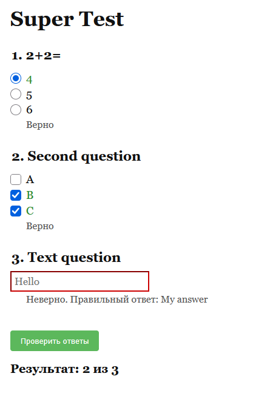

# Lab Work: Quiz Form Generator

A simple Java project. The program reads a quiz description written in a small DSL and creates an HTML file with a form. The page is stored in one file: JavaScript reads the questions from JSON that is embedded directly into the HTML.

## Technologies

- Java 21
- Gson 2.11.0 (stored in the `lib` folder)
- Java Collections Framework
- Stream API

## Project Structure

- `QuizSpec.java` - quiz model: questions, options, answer type.
- `QuizDslParser.java` - parses the DSL text into the model and checks for errors.
- `HtmlQuizGenerator.java` - turns the model into HTML. First Gson creates JSON, then it is inserted into the page.
- `Main.java` - entry point, takes two files: input and output.

## DSL Syntax

Directives:

- `Title` - browser tab title
- `H1` - page heading
- `Style` - style, `default` by default

A question starts with `?` and ends with the answer type:

- `r` - one correct option
- `c` - multiple correct options
- `t` - text answer

Options are written with `-`, the correct one is marked with `+`. The end of the block is `e`. For a text question the answer is written with `_`.

Example:

```
Title My title
H1 Super Test
? 2+2= r
- 4 +
- 5
- 6 e
? Second question c
- A
- B +
- C +e
? Text question t
_ My answer
```

## How to Run

Open a command prompt in the project folder.

Build:

```
build.bat
```

Run with the default file:

```
run.bat
```

In this case `examples/quiz.txt` is read and the result is written to `quiz.html`.

Run with your own files:

```
run.bat my.quiz result.html
```

You can also run it without the batch files (in PowerShell, quotes are needed around the `-Dfile.encoding` parameter):

```
javac -encoding UTF-8 -cp lib/gson-2.11.0.jar -d out src/main/java/quiz/*.java
java '-Dfile.encoding=UTF-8' -cp out;lib/gson-2.11.0.jar quiz.Main examples/quiz.txt quiz.html
```

## How to Check

After running, open `quiz.html` in a browser. Answer the questions and click the "Проверить ответы" button. Each question is marked with "Верно" or "Неверно. Правильный ответ: ...". The result like "Результат: 3 из 3" appears at the bottom. A text answer can be written in any case - the program takes this into account.

## Possible Errors

The parser reports the line number and the reason. For example, if a block of options is not closed, there is no correct answer, or several options are marked in a question with one choice.

## Screenshot


